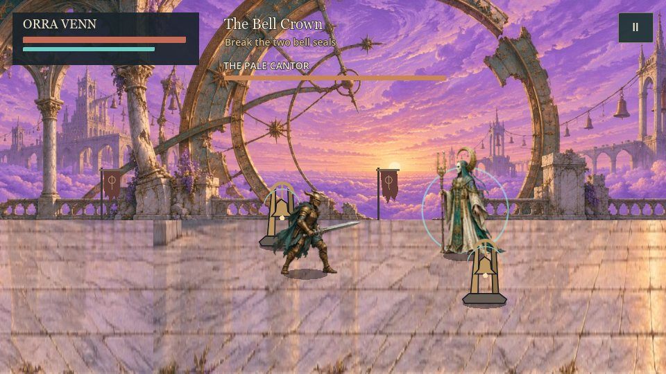

# Shadow Realms — Cinder Keep

A short side-scrolling campaign in Godot 4.7.2. Follow the bells through six encounters from the Ash Causeway to the execution foundry and the Bell Crown. The Lantern Headsman guards the forge. Beyond it, break the two bell seals shielding the Pale Cantor and step out of his closing rings.


## Play on Windows

For the standalone Windows build, extract the Windows archive and open **ShadowRealms.exe**. The Android build is a debug-signed arm64 APK.

To play from source, open **project.godot** in Godot 4.7.2 Standard and press **F6** from the Keep scene or **F5** from anywhere. Alternatively, double-click **Play.cmd**. The launcher checks GODOT_BIN, the PATH and the standard extracted 4.7.2 download location. It imports project assets before starting.

Select **Enter the keep**, choose a name, then select **Begin**. Walk east between encounters. A marker above an enemy and a strip on the floor show attack windup. Step across the road to evade. Between encounters, cross the dropped flasks to restore vitality and magic. Retry restores the current encounter. Continue on the title screen loads the selected hero and last saved encounter. Completing the campaign clears that slot.

| Input | Action |
| --- | --- |
| WASD or arrows | Walk horizontally and change depth |
| J | Attack. Tap again near the end of recovery to chain melee strikes |
| K | Jump. Clear a low strike or projectile near the apex |
| Shift | Hero special. Face an incoming melee swing and tap during its cyan flash to interrupt and regain 15 magic |
| L | Magic. Costs 30 of 100 and slowly regenerates |
| Esc or pause button | Pause, resume, restart or change sound |

On touchscreens use the left stick and the four labeled buttons. Controls scale with the 960 × 540 playfield. Wider screens use letterboxing.

| Hero | Fighting style |
| --- | --- |
| Orra Venn | Highest health, three-cut greatsword chain, charged cleave and radial tide ring |
| Edrin Vey | Lower health, ranged fire lances, evasive step and storm field |
| Vessa Rill | Fastest movement, paired knife chain, lunging dodge and tide ring. Finish the chain against a winding-up enemy for bonus damage |

## Orra's raider throw

Walk into a grounded raider in the same lane with Orra. On contact she automatically grabs, turns toward the raider and throws them forward. No attack button is required. Line up another enemy to knock them down. Outside body contact, Strike keeps the normal sword chain.

## Orra's running shoulder

Double-tap left or right and hold the second press. On touch, push the stick sideways, return it to center, then push and hold in the same direction. After a short run-up, press Strike to commit to a shoulder charge. A grounded enemy in your lane is knocked back. A miss carries Orra forward before she brakes. Releasing the direction ends the run. Striking from a standstill uses her normal blade chain.

## First sword contact

Orra plants her weight, steps into the first cut and follows through. The collision reach extends with the two forward blade poses. Confirmed contact holds just the two fighters for 50 ms, while a miss continues straight into recovery. The cut hits each opponent once. To compare both cases, run `godot --headless --fixed-fps 60 -s res://tests/opening_cut.gd`.

## Jump combat and ember power

Tap Jump for a short hop or hold it for a high arc. You can steer along either axis and use one aerial strike per jump. Orra plunges down and damages enemies on both sides on landing. Edrin fans three falling embers into adjacent lanes. Vessa dives forward with both blades. On touch, hold or release Jump independently of the stick and Strike.

At medium range the brute can break the ground, sending low stone spikes toward you. Jump them or leave their lane. A raider alternates its jab with a rising hook that can catch airborne heroes. Step sideways during the pink upward warning. Collect the golden ember after the first, third or fifth encounter for twelve seconds of +50% attack damage. The HUD counts down the remaining time. Picking up another refreshes the duration.

## Android debug build

Install the export templates matching Godot 4.7.2 from **Editor → Manage Export Templates**. Install OpenJDK 17 and the Android SDK command-line tools. From the SDK tools directory, install the required packages, substituting the actual SDK location for SDK_ROOT.

```text
sdkmanager --sdk_root=SDK_ROOT "platform-tools" "build-tools;35.0.1" "platforms;android-35" "cmdline-tools;latest" "cmake;3.10.2.4988404" "ndk;28.1.13356709"
sdkmanager --sdk_root=SDK_ROOT --licenses
```

In Godot Editor Settings under Export → Android, enter your Java SDK and Android SDK paths. Open the project once to import resources. With Godot and adb on PATH, run from the repository root in PowerShell.

```powershell
New-Item -ItemType Directory -Force build
godot --headless --export-debug Android build/ShadowRealms.apk
adb install -r build/ShadowRealms.apk
```

Enable USB debugging and accept the device authorization before installing. The included preset targets arm64. [Godot 4.7 Android export guide](https://docs.godotengine.org/en/4.7/tutorials/export/exporting_for_android.html)

## Code and assets

The Keep scene owns a scrolling, Y-sorted road and a screen-space interface. The wave controller manages arena gates, projectiles and checkpoints. The shared fighter owns health, movement, combat states, collision shapes, jump height and AI decisions. Rules define individual move timings, ranges, damage and stats. Visuals can be replaced clip by clip. [Asset manifest and rig guide](docs/ASSETS.md)

## Validation and remaining work

Godot 4.7.2 imported the project and rendered it using the OpenGL compatibility renderer on Windows with Intel UHD 630 graphics. Automated input runs selected each hero through the menu, traversed all six encounters, observed the second boss phase and reached the completion screen. All three runs received enemy damage. Reproduce after import with Godot on PATH.

```text
godot --headless -s res://tests/checks.gd
godot --headless --fixed-fps 60 -s res://tests/playthrough.gd
godot --headless --fixed-fps 60 -s res://tests/playthrough.gd -- seer
godot --headless --fixed-fps 60 -s res://tests/playthrough.gd -- swift
```

Focused checks exercise lane misses, live hitboxes, one damage event per swing, insufficient magic, two simulated touch IDs, health pickup, defeat and checkpoint retry. The graphical capture script opens the renderer and writes actual viewport images to a directory supplied after the double dash.

The Windows x86-64 release uses an embedded resource pack. The Android debug export uses the matching 4.7.2 template, OpenJDK 17, Android build tools 35.0.1 and arm64-v8a. On-device multitouch, physical audio, app suspension and sustained 60 FPS still need measurement. The dedicated headless tests skip playback on the dummy audio driver.

The focused checks also exercise counter timing, furnace warnings, jump clearance, single burns, boss shields and disk checkpoints. To include the disk test, set SR_TEST_SAVE to a temporary writable filename before running checks.gd. The new enemies use four illustrated poses apiece. Additional animation frames, long-session playtesting and accessibility testing remain production work.


