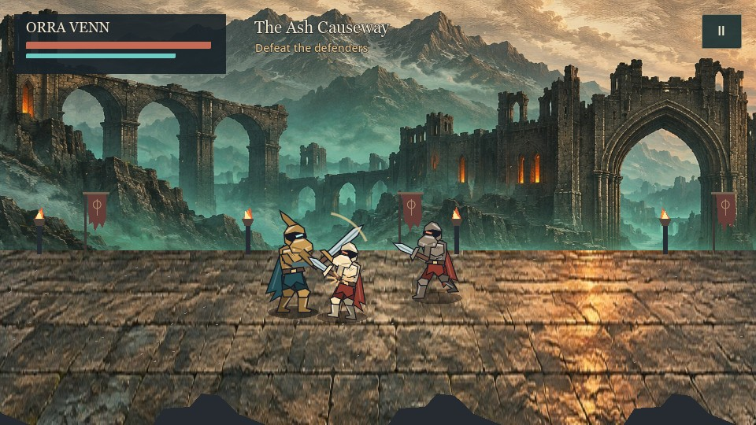

# Shadow Realms — Cinder Keep

A playable single-level Godot 4 beat-’em-up for landscape play. Choose one of three heroes, cross the Ash Causeway and the Broken Choir, and defeat the Lantern Headsman at the Sentence Gate.



## Play on Windows

Open **project.godot** in Godot 4.7.2 Standard and press **F6** from the Keep scene or **F5** from anywhere. Alternatively, double-click **Play.cmd**. The launcher checks GODOT_BIN, the PATH and the standard extracted 4.7.2 download location. It imports project assets before starting.

Select **Enter the keep**, choose a name, then select **Begin**. Walk east between encounters. A marker above an enemy and a strip on the floor show attack windup. Step across the road to evade. After each of the first two waves, cross the dropped flasks to restore vitality and magic. Retry restores the current encounter within this session.

| Input | Action |
| --- | --- |
| WASD or arrows | Walk horizontally and change depth |
| J | Attack. Tap again near the end of recovery to chain melee strikes |
| K | Jump. Clear a low strike or projectile near the apex |
| Shift | Hero special |
| L | Magic. Costs 30 of 100 and slowly regenerates |
| Esc or pause button | Pause, resume, restart or change sound |

On touchscreens use the left stick and the four labeled buttons. Controls scale with the 960 × 540 playfield. Wider screens use letterboxing.

| Hero | Fighting style |
| --- | --- |
| Orra Venn | Highest health, three-cut greatsword chain, charged cleave and radial tide ring |
| Edrin Vey | Lower health, ranged fire lances, evasive step and storm field |
| Vessa Rill | Fastest movement, paired knife chain, lunging dodge and tide ring. Finish the chain against a winding-up enemy for bonus damage |

## Android debug build

Install the export templates matching Godot 4.7.2 from **Editor → Manage Export Templates**. Install OpenJDK 17 and the Android SDK command-line tools. From the SDK tools directory, install the required packages, substituting the actual SDK location for SDK_ROOT.

```text
sdkmanager --sdk_root=SDK_ROOT "platform-tools" "build-tools;35.0.1" "platforms;android-35" "cmdline-tools;latest" "cmake;3.10.2.4988404" "ndk;28.1.13356709"
sdkmanager --sdk_root=SDK_ROOT --licenses
```

In Godot Editor Settings under Export → Android, enter your Java SDK and Android SDK paths. Open the project once to import resources. With Godot and adb on PATH, run from the repository root in PowerShell.

```powershell
New-Item -ItemType Directory -Force build
godot --headless --export-debug Android build/ShadowRealms.apk
adb install -r build/ShadowRealms.apk
```

Enable USB debugging and accept the device authorization before installing. The included preset targets arm64. [Godot 4.7 Android export guide](https://docs.godotengine.org/en/4.7/tutorials/export/exporting_for_android.html)

## Code and assets

The Keep scene owns a scrolling, Y-sorted road and a screen-space interface. The wave controller manages arena gates, projectiles and checkpoints. The shared fighter owns health, movement, combat states, collision shapes, jump height and AI decisions. Rules define individual move timings, ranges, damage and stats. Visuals can be replaced clip by clip. [Asset manifest and rig guide](docs/ASSETS.md)

## Validation and remaining work

Godot 4.7.2 imported the project and rendered it using the OpenGL compatibility renderer on Windows with Intel UHD 630 graphics. Automated input runs selected each hero through the menu, traversed all three encounters, observed the second boss phase and reached the completion screen. All three runs received enemy damage. Reproduce after import with Godot on PATH.

```text
godot --headless -s res://tests/checks.gd
godot --headless --fixed-fps 60 -s res://tests/playthrough.gd
godot --headless --fixed-fps 60 -s res://tests/playthrough.gd -- seer
godot --headless --fixed-fps 60 -s res://tests/playthrough.gd -- swift
```

Focused checks exercise lane misses, live hitboxes, one damage event per swing, insufficient magic, two simulated touch IDs, health pickup, defeat and checkpoint retry. The graphical capture script opens the renderer and writes actual viewport images to a directory supplied after the double dash.

Android SDK, JDK and matching export templates were unavailable on the test host. The APK, real multitouch, phone audio, suspend/resume and sustained 60 FPS still require device validation. Windows sandbox diagnostics included root certificate and editor-cache access warnings and intermittent audio object warnings on exit. The game runs offline.

Before release, test low- and midrange Android devices over sustained sessions, measure frame times, tune boss difficulty with human players, expand the short level, finish bespoke character animation and add individual enemy vocals. Checkpoints last for the current run. The build currently provides one fortress level and three encounters.

